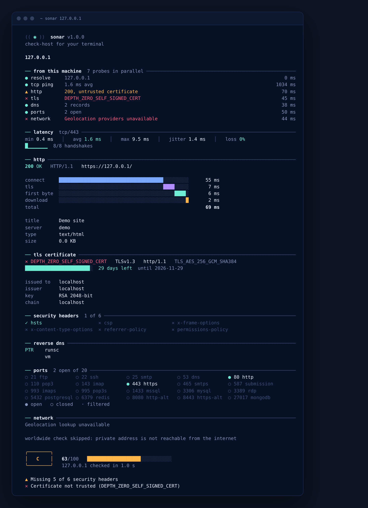
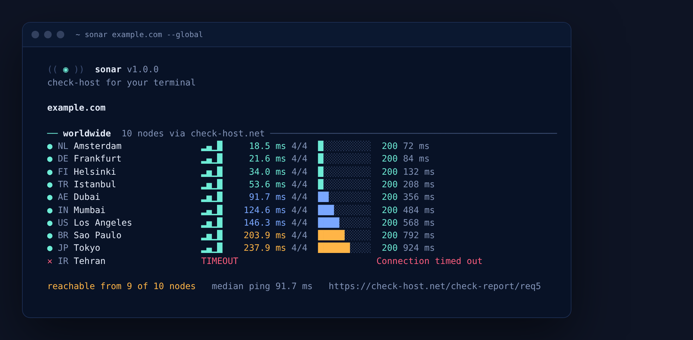

<div align="center">

# ◉ sonar

**check-host برای ترمینال** — یک دامنه یا IP بده، بقیه‌اش با سونار

Check any domain or IP straight from your terminal: DNS, latency, HTTP timing, TLS,
open ports, network location — and reachability from servers around the world.


</div>

```bash
sonar github.com
```

<p align="center"></p>

<div dir="rtl">

## چه کار می‌کند؟

یک دستور، دو نگاه:

**از روی سیستم خودت** — هفت کاوشگر همزمان اجرا می‌شوند و نتیجه‌ها زنده روی ترمینال می‌نشینند:

| کاوشگر | چه چیزی را می‌سنجد |
|---|---|
| `resolve` | تبدیل دامنه به IP (همه‌ی آدرس‌های IPv4 و IPv6) |
| `tcp ping` | تأخیر با دست‌دهی TCP روی پورت 443/80/22 — کمینه، میانگین، بیشینه، لرزش و افت بسته |
| `http` | کد پاسخ، زمان‌بندی مرحله‌به‌مرحله (اتصال، TLS، اولین بایت، دریافت)، مسیر ریدایرکت، سرور، CDN، عنوان صفحه |
| `tls` | اعتبار گواهی، روزهای باقی‌مانده تا انقضا، صادرکننده، پروتکل، رمز، ALPN، زنجیره‌ی گواهی |
| `dns` | رکوردهای A، AAAA، CNAME، MX، NS، TXT، CAA، SOA + بررسی SPF و DMARC (برای IP: رکورد PTR) |
| `ports` | اسکن ۲۰ پورت رایج و هشدار برای پورت‌های حساس باز (MySQL، Redis، RDP و…) |
| `network` | موقعیت جغرافیایی، ASN، ISP و منطقه‌ی زمانی |

**از سراسر دنیا** — همان هدف از نودهای [check-host.net](https://check-host.net) در کشورهای مختلف پینگ و HTTP می‌شود؛ می‌فهمی سایت از بیرون شبکه‌ی خودت هم در دسترس است یا نه (مثلاً از ایران باز می‌شود ولی از آلمان نه، یا برعکس).

در پایان یک **نمره از ۱۰۰ و گرید A+ تا F** می‌گیری، به‌همراه فهرست مشکلاتی که باید درست شوند.

<p align="center"></p>

## نصب

فقط [Node.js](https://nodejs.org) نسخه‌ی ۱۸.۱۷ یا جدیدتر لازم است. هیچ وابستگی‌ای نصب نمی‌شود.

</div>

```bash
git clone https://github.com/amirjrha/sonar.git
cd sonar
npm link          # دستور sonar را در کل سیستم فعال می‌کند
```

<div dir="rtl">

بدون نصب هم می‌شود اجرا کرد:

</div>

```bash
node bin/sonar.js example.com
```

<div dir="rtl">

یا با Docker:

</div>

```bash
docker build -t sonar .
docker run --rm -it sonar example.com
```

<div dir="rtl">

## استفاده

</div>

```bash
sonar github.com                         # همه‌ی بررسی‌ها
sonar 1.1.1.1                            # آدرس IP
sonar https://example.com/login          # URL کامل هم قبول است
sonar example.com google.com 8.8.8.8     # چند هدف پشت سر هم

sonar example.com --local                # فقط از روی سیستم خودت
sonar example.com --global --nodes 30    # فقط از ۳۰ نود در دنیا
sonar example.com -p 22,80,443,5432      # پورت‌های دلخواه
sonar example.com --json > report.json   # خروجی JSON برای اسکریپت‌ها
```

| گزینه | توضیح |
|---|---|
| `-l`, `--local` | فقط بررسی از روی سیستم خودت |
| `-g`, `--global` | فقط بررسی جهانی (check-host.net) |
| `-n`, `--nodes <n>` | تعداد نودهای جهانی (پیش‌فرض ۱۶، حداکثر ۴۰) |
| `-p`, `--ports <list>` | پورت‌های اسکن، جدا شده با کاما |
| `-c`, `--count <n>` | تعداد پینگ TCP (پیش‌فرض ۸) |
| `--no-ports` | رد کردن اسکن پورت |
| `--json` | خروجی JSON به‌جای گزارش رنگی |
| `--no-color` | بدون رنگ (متغیر `NO_COLOR` هم پشتیبانی می‌شود) |

<div dir="rtl">

### کد خروج (برای مانیتورینگ و CI)

اگر هدف در دسترس باشد و نمره‌اش ۶۰ یا بیشتر (گرید C به بالا) باشد، خروجی `0` است؛ وگرنه `1`. پس می‌شود در کرون‌جاب یا CI از آن استفاده کرد:

</div>

```bash
sonar mysite.com --local --no-ports || notify-send "mysite.com is down"
```

<div dir="rtl">

### نمره چطور حساب می‌شود؟

</div>

| بخش | امتیاز |
|---|---|
| در دسترس بودن (پینگ TCP) | ۱۰ |
| سرعت پاسخ (میانگین تأخیر) | ۱۵ |
| پاسخ HTTP سالم | ۲۰ |
| هدرهای امنیتی (HSTS، CSP و…) | ۱۵ |
| گواهی TLS معتبر + پروتکل مدرن + فاصله تا انقضا | ۲۵ |
| SPF و DMARC | ۵ |
| نبودِ پورت حساس باز | ۱۰ |

<div dir="rtl">

## چند نکته

- **پینگ با TCP است، نه ICMP.** پینگ ICMP دسترسی root می‌خواهد و خیلی از سرورها آن را می‌بندند؛ دست‌دهی TCP بدون دسترسی ویژه کار می‌کند و همان چیزی است که کاربر واقعی تجربه می‌کند.
- **بررسی جهانی** از API عمومی و رایگان check-host.net استفاده می‌کند و محدودیت تعداد درخواست دارد. اگر خطای rate limit دیدی، یک دقیقه صبر کن.
- **موقعیت جغرافیایی** از سرویس‌های رایگان ipwho.is و ip-api.com گرفته می‌شود (اگر اولی جواب ندهد، دومی).
- آدرس‌های خصوصی (مثل `192.168.1.10`) را هم می‌شود از روی سیستم خودت بررسی کرد؛ فقط بخش جهانی برایشان اجرا نمی‌شود.
- اسکن پورت را فقط روی سرورهایی انجام بده که مال خودت است یا اجازه‌اش را داری.

## ساختار پروژه

</div>

```
sonar/
├── bin/sonar.js          # CLI: آرگومان‌ها، اجرای بررسی‌ها، خروجی
├── src/
│   ├── runner.js         # هماهنگ‌کننده‌ی کاوشگرها و محاسبه‌ی نمره
│   ├── target.js         # تشخیص و نرمال‌سازی دامنه / IP / URL
│   ├── global.js         # کلاینت API سایت check-host.net
│   ├── checks/           # dns, tcp (ping + ports), http, tls, geo
│   └── ui/               # رنگ، جدول، نمودار و رندر زنده در ترمینال
├── test/                 # تست‌ها با node:test
└── docs/                 # تصاویر README
```

```bash
npm test
```

<div dir="rtl">

## استفاده به‌عنوان کتابخانه

</div>

```js
const { runChecks } = require('sonar-checkhost');

const report = await runChecks('example.com', (event, data) => {
  if (event === 'check') console.log(data.id, data.status, data.summary);
});
console.log(report.score); // { value: 92, grade: 'A' }
```

---

<details>
<summary><b>English</b></summary>

**sonar** is a zero-dependency Node.js CLI that runs a full health check on any domain, IP or URL:

- **From your machine**, seven probes in parallel with a live display: DNS resolution, TCP latency (min/avg/max/jitter/loss), HTTP status with a connect → TLS → first byte → download waterfall and redirect chain, TLS certificate (trust, expiry, issuer, protocol, cipher, chain), full DNS records with SPF/DMARC, a scan of 20 common ports flagging exposed databases and remote access, and IP geolocation + ASN.
- **Worldwide**, through the public [check-host.net](https://check-host.net) API: ping and HTTP from up to 40 nodes in different countries, sorted by latency, so you can tell whether a site is reachable from outside your own network.
- A **0–100 score and A+…F grade**, plus a list of concrete findings.

```bash
git clone https://github.com/amirjrha/sonar.git && cd sonar && npm link
sonar github.com
sonar 1.1.1.1 --global --nodes 30
sonar example.com --json > report.json
```

Requires Node.js 18.17+. Exits `0` when the target is reachable and grades C or better, `1` otherwise.
Only scan ports on hosts you own or are allowed to test.

</details>

<div dir="rtl">

## مجوز

MIT — هر کاری خواستی با آن بکن.

<sub>تصاویر بالا از اجرای ابزار روی سرورهای آزمایشی گرفته شده‌اند.</sub>

</div>
